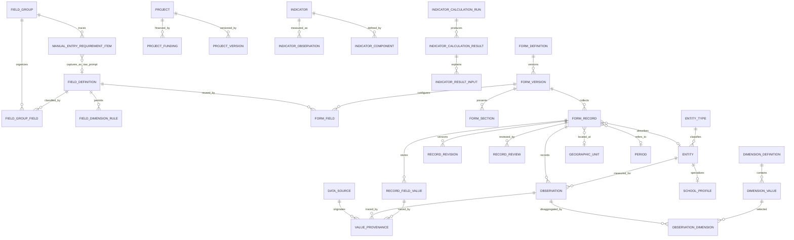

# المعمارية الكانونية للبيانات التنموية

## 1. القرار المعماري

نستكمل النموذج الهجين الموجود في SQLite ولا نبني قاموساً أو مخزناً موازياً. يكون `field_definitions` هو المرجع الدلالي للحقول التي تم تعريفها فيه، وتكون `form_definitions` ونسخها مسؤولة عن طريقة الجمع والعرض، وتكون `domain-registry.cjs` قائمة سماح تقنية للجداول والخدمات لا مرجعاً للاعتماد الدلالي. تستخدم الكيانات والجداول المتخصصة لهويات وأحداث مستقلة، وتستخدم `observations` لقيم القياس المتغيرة حسب الموقع والفترة والأبعاد.

لا يعد أي تعريف مؤقتاً معتمداً لمجرد وجوده في قاعدة البيانات. الحقول المقترحة وروابط الاسم المرشحة تظل للمراجعة ولا تفتح كتابة أو تحليلاً رسمياً. جمع البيانات الخام وظيفة مستقلة عن اعتماد المتغير أو الوحدة أو المنهجية أو النتيجة.

## 2. النموذج المفاهيمي

الأسماء في الرسم مختصرة: `FIELD_GROUP` تقابل `field_groups`، و`FIELD_DEFINITION` تقابل `field_definitions`، و`MANUAL_ENTRY_REQUIREMENT_ITEM` تقابل سجل تتبع بنود المواصفة `manual_entry_requirement_items`، و`SCHOOL_PROFILE` تقابل جدول `schools`. الرسم يوضح العلاقات التي تنفذها الجداول، لا اقتراح جدول جديد لكل مستطيل. سجل المتطلبات يحفظ العبارة المصدرية وحالتها وربطاً اختيارياً بحقل التقاط خام؛ لا ينافس القاموس الدلالي ولا يجعل العبارة تعريفاً معتمداً.

## 3. النموذج المنطقي والفيزيائي الحالي المعتمد

| المفهوم | الجداول/الخدمة المعتمدة | قاعدة الاستخدام |
|---|---|---|
| المجال والمجموعة وبنود المواصفة | `field_groups`, `field_group_fields`; وكتالوج المجالات `manual_entry_domains`, `manual_entry_groups`; وسجل التتبع `manual_entry_requirement_items` | شجرة `field_groups` تصنف الحقول الدلالية. كتالوج الإدخال يصف مجال المواصفة والتغطية والحالة. سجل المتطلبات يحفظ 299 عبارة مفهرسة، ويربط 292 منها بحقول التقاط مؤقتة و7 بقدرات مشتركة؛ الربط الخام لا يكرر معنى الحقل ولا يثبت تعريفه الدلالي. |
| تعريف الحقل | `field_definitions`, `field_definition_aliases`, `field_dimension_rules` | الرمز `field_code` ثابت؛ الاسم والوصف والنوع التقني والمعنى الدلالي والوحدة/التصنيف والأبعاد حقائق منفصلة. لا يعتمد alias أو candidate mapping ما لم يوافق عليه صراحة. |
| تعريف واجهة الجمع | `form_definitions`, `form_versions`, `form_sections`, `form_fields`, `form_row_definitions` | `form_fields.field_definition_id` يعيد استعمال تعريف الحقل، فيما تحدد حقول النموذج ترتيب العرض، والمكوّن عبر نوع البيانات/التخزين، والإلزام والتحقق والسماح بالاستيراد. `definition_hash` وإصدار النموذج يحفظان تطور العقد. |
| تعريف القيمة المرجعية | `reference_sets`, `reference_values` | يستعمل لقائمة ذات هوية وثبات نسبي؛ لا يحول وصفاً غامضاً إلى قائمة من اختيارنا. أضيف `education_school_kind_v1` لنموذج الجمع وفق القيمتين المذكورتين في النموذج الحالي، وبقيتا غير مثبتتين خارج هذا النطاق. |
| بُعد القياس | `dimension_definitions`, `dimension_values`, `field_dimension_rules`, `manual_entry_form_field_dimensions` | الجنس والعمر والفترة والمكان أبعاد، لا أعمدة متكررة لكل تركيبة. قواعد البعد المسموح به لا تعني أن كل قيمة أو نطاق جغرافي قد اعتمد منهجياً. |
| الهوية | `entities`, `entity_types`, `entity_identifiers`, `entity_relationships` والملفات المتخصصة مثل `schools`, `health_facilities`, `water_assets` | تخزن هوية كيان مستقل واسم/موقع ونوعه، ثم صف نوعي للخصائص التي لها جدول مخصص. القيم الوصفية غير المحسومة تبقى مرتبطة بسجل الجمع مع مصدرها. |
| سجل الجمع | `form_records`, `record_field_values` | السجل يجمع حالة النموذج والموقع والفترة والكيان الأب/الكيان الموصوف وحالة المراجعة. القيم الوصفية/المرجعية ترتبط بتعريفات الحقول ولا تضاف كأعمدة لكل مجموعة. |
| القياس | `observations`, `observation_dimensions` | قيمة، حالة، وحدة، موقع، فترة، حقل، كيان اختياري، مصدر. حالات `zero`, `unknown`, `not_available`, `not_applicable`, `not_collected`, `not_verified` متميزة ولا تختزل إلى صفر/NULL دلالياً. |
| المصدر والتاريخ | `data_sources`, `value_provenance`, `record_revisions`, `record_reviews`, `audit_events` | يحفظ المصدر/الموقع أو الخلية والقيمة الخام والمطَبّعة والفاعل والتوقيت والقرار حيث تتوفر. عدم وجود معلومة مصدر لا يبرر اختلاقها. |
| حدث/معاملة | `projects`, `project_funding`, `project_activities`, `project_milestones`, `revenue_transactions`, `expenditure_transactions`, `budget_lines` | لكل حدث/معاملة مفتاح وعلاقات وتاريخ/حالة وحقول نوعية؛ لا يخزن الحدث كسلسلة نصية داخل ملاحظة أو كـEAV شامل. حقل الكلفة في سجل المشروع لا يستبدل المعاملة المالية. |
| مؤشر/تشغيل | تعريفات المؤشرات وإصداراتها ومكوناتها وأوزانها ومستهدفاتها و`indicator_observations`, `indicator_calculation_runs`, `indicator_calculation_results`, `indicator_result_inputs` | التعريف المنهجي والمدخل والنتيجة وتشغيلها منفصلة. تحفظ نسخة مدخلات التحليل عند التشغيل؛ البيانات الخام/غير المؤهلة لا تدخل الترتيب الرسمي. |
| ملف Excel | `workbook_import_batches`, `workbook_import_sheets`, `workbook_import_regions`, `workbook_import_rows`, `workbook_import_cells`, ثم جداول `import_*` | يحتفظ بالملف الأصلي والبصمة والأوراق والخلايا والمعلومات المكانية، مع نتائج المطابقة والمراجعة. Excel ليس قاموساً ولا قاعدة الحقيقة. |
| بيانات تحليل المديريات | `entity_records`/`entity_field_values` للمسار المعياري المقروء، مع جداول التوافق القديمة | ما زالت أجزاء من التحليل مخصصة للمديريات. يلزم المحافظة على الربط التاريخي مع `directorates` حتى يثبت انتقال كل الوظائف والبيانات. |

### ما لا نضيفه

- لا جدول EAV واحد يختزن كل صفة وهوية ومعاملة ومؤشر.
- لا جدول قطاعي لكل حقل أو لكل مجموعة إدخال.
- لا تكرار لمفهوم الحقل في الكتالوج كتعريف بديل عن `field_definitions`.
- لا تحويل وحدة أو تعويض قيمة مفقودة أو حساب مؤشر استناداً إلى تخمين أو مجرد وجود قيمة رقمية.

## 4. مسؤوليات مصادر الحقيقة والعقود

| المسؤولية | مصدر الحقيقة | ما لا يملكه |
|---|---|---|
| المعنى الدلالي للحقل | `field_definitions` وسجل أبعاده ومراجعه وأسمائه البديلة | لا يقرر تخطيط شاشة النموذج أو الجدول الفيزيائي المنفرد لكل قطاع. |
| تنظيم المتطلبات الـ18 | `manual_entry_domains`/`manual_entry_groups` مع سجل التغطية ومتطلبات المواصفة | لا ينشئ تعريفاً دلالياً جديداً أو بيانات تشغيلية بالتوازي. |
| شكل الإدخال وإصداره | `form_definitions` و`form_versions` و`form_fields` | لا يثبت اعتماد المنهجية أو المصدر لمجرد نشر النموذج. |
| التخزين القطاعي | جداول الكيانات/المعاملات/المشاهدات المحددة وخدمة لها عقد | لا تسمح الواجهة بتحديد اسم جدول/عمود؛ قائمة `DATASETS` قائمة سماح تقنية وليست قاموس معنى. |
| مصدر القيمة | `data_sources` و`value_provenance` وبيانات استيراد الخلية | لا تملأ مصدر مفترض. |
| مراجعة القيمة | `form_records.record_status`, `record_reviews`, `data_quality_issues` | لا تساوي اعتماد المنهجية أو أهلية التحليل. |
| التحليل الرسمي | مدخلات مؤهلة وتعريف/إصدار/تشغيل محفوظ في خدمة التحليل | لا يقرأ نماذج الجمع الأولي غير المؤهلة أو يستنتج مؤشرات تلقائياً. |

## 5. تطبيق الأنواع الثلاثة الممثلة

### أ. كيان وصفي: مدرسة أو روضة

1. نموذج `education_school_collection_v1` يولد الحقول من `field_definitions`/`form_fields` ويخزن المسودة في `form_records` و`record_field_values`، مع المصدر في `value_provenance`.
2. لا تنشأ هوية canonical قبل الاعتماد؛ ذلك يمنع المسودة من الظهور ككيان رسمي.
3. عند الاعتماد، `record-service.cjs` يتحقق من اسم المنشأة ونوعها من المجموعة المرجعية، ثم ينشئ أو يحدث `entities` بنوع `education_facility` و`schools.school_type_id`، ويربط `form_records.entity_id` ويربط قياسات السجل بالكيان. يسجل الأثر في `audit_events`.
4. `education_facility` نوع جامع للمدرسة والروضة؛ قيمة النوع التفصيلية تبقى في `schools.school_type_id`. الحقول مثل جنس المدرسة وحالة المبنى تبقى خاماً كما وردت ولا تتحول إلى مرجع معتمد.
5. لا ينشئ المسار `indicator_observations` ولا يمنح النموذج أهلية تحليلية.

### ب. قياس متعدد الأبعاد: السكان حسب العمر والجنس

1. تعريف `population.age_sex` مرتبط بوحدة/بعدي `sex` و`age_group` ضمن إصدار نموذج الجمع.
2. حفظ `37` مع بعدي `female` و`6_14` يكتب صفاً في `observations` وصفين في `observation_dimensions`، ويمرر الفترة والموقع والمصدر؛ لا ينشئ حقلاً منفصلاً لكل زوج أبعاد.
3. القراءة تعيد القيمة والأبعاد والمصدر. التعديل ينشئ نسخة مراجعة/مصدر جديدة ويحدث القياس نفسه مع حفظ تاريخ المصدر.
4. النموذج الأولي يحتفظ بـ`analysis_eligible=0` و`methodology_status='not_defined'`; لا يذهب القياس إلى جدول نتائج المؤشرات الرسمية.

### ج. حدث/معاملة: مشروع وتمويل

1. سجل المشروع المركزي يحفظ البيانات العامة للحدث، ثم يزامن المعتمد إلى `projects` ويسجل علاقة توافق وإصداراً سابقاً.
2. سجل التمويل له نموذج وعلاقة أب واضحة إلى مشروع معتمد، ويزامن عند اعتماد سجل التمويل فقط إلى `project_funding` مع المصدر.
3. يمنع حفظ تمويل بلا مشروع أب معتمد، ويثبت الاختبار استمرارية الربط بعد القراءة/التعديل/المراجعة، وظهور التمويل عبر القراءة الكانونية.
4. هذا يثبت المسار لهذه الأشكال المختبرة، لا تغطية كل الإيرادات/النفقات أو جميع أحداث التنفيذ. جداول `revenue_transactions` و`expenditure_transactions` تبقى جداول معاملات مستقلة مع خدماتها.

## 6. دورة الحياة والتحليل

`form_versions.status='published'` شرط قدرة نموذج على جمع سجل في `record-service`. النموذج المنشور قد يكون جمعاً أولياً ولا يعني اعتماد الحقول/المصدر/المنهجية. السجل يمر بـ`draft → pending_review → approved/rejected` مع أسباب وإصدارات وتدقيق. إعادة فتح السجل المعتمد تتطلب سبباً، وتسمح بالتعديل وفق قواعد الخدمة.

تأهيل التحليل شرط منفصل مسجل في `manual_entry_form_governance` و`manual_entry_form_field_governance`، وحالة التحقق للقياس مستقلة عن حالة مراجعة السجل. التحويل إلى `indicator_observations` يجري لمسار محدد وباختبارات للمؤشر والموقع والفترة والوحدة والحالة والتكرار. لا تُستخدم بيانات ما زالت أولية في ترتيب المديريات أو النتيجة الرسمية.

## 7. تغطية المواصفة وحدود التعريف

يحتوي كتالوج المتطلبات 18 مجالاً و86 مجموعة تشغيلية؛ أما سجل المواصفة فيحتوي 18 مجالاً و85 مجموعة و299 بنداً مفهرساً. من هذه البنود 7 قدرات مشتركة مدعومة و292 بند التقاط خام نصي في 84 مجموعة؛ النموذج النصي لا يساوي حقلاً دلالياً معتمداً ولا يفكك البند المركب إلى متغيرات ذَرّية. ما زال 279 بنداً يحتاج تصنيفاً على مستوى العنصر، و255 له مرشحات غير معتمدة فقط، و19 له دليل جزئي لنموذج موصوف منشور، و18 بلا ربط بحقل دلالي حالي. وجد السجل تطابقاً اسمياً غير موثق لبعض 45 بنداً؛ بند واحد فقط له تقاطع مع اسم حقل منشور، ولا يعد ذلك اعتماداً دلالياً. في المخطط الاصطناعي يوجد 84 نموذج جمع خام بحقولها الـ292، إضافة إلى النموذجين الأوليين ذوي 8 حقول موصوفة؛ لا يوجد أي منها مؤهلاً للتحليل رسمياً. هذه الأعداد تصف السجل المولد والكتالوج، ولا تتحول إلى نسبة اكتمال نهائية أو تعميم على بيانات تشغيلية.

المسائل غير المحسومة تظل على مستوى البند:

- تعريفات/وحدات/مصادر متعددة من قوائم المتطلبات لا يمكن إثباتها من اسم الحقل وحده.
- تصنيف أبعاد/نطاق/زمن لبعض المتغيرات يحتاج مواصفة أو مراجعة قطاعية.
- المجموعات الوصفية التي لا تمثل حقلاً واحداً لا تحول آلياً إلى صفات/كيانات/مؤشرات دون تحديد بنودها.
- لا تعتمد قائمة تعليمية محلية أو مرشح حقل في `field_group_fields` لمجرد وجوده؛ حالة الاعتماد ومصدره لازمَان.
- يتعين مراجعة أي عمود مكتشف في SQLite ولا يملك تعريفاً في `DATASETS` قبل تحريره؛ أصبح مرفوض الكتابة في الخدمة إلى أن يضاف تعريف موثق.

## 8. الترحيل والتوافق

المسار المعمول به هو **Expand → Migrate → Verify → Contract**:

1. **Expand:** التغييرات الجديدة إضافية. الإصدارات 9 و10 يضيفان نوع كيان تعليمي وربط سجلات تعليمية معتمدة قديمة. الإصدار 11 يضيف فهرس تتبع لعبارات المواصفة وحقول جمع خام غير مؤهلة للتحليل، من دون حذف أو استبدال التعريفات السابقة.
2. **Migrate:** ربط السجل بالكيان عند الاعتماد، مع ترحيل معاد التشغيل وفق `schema_migrations`. ترحيل الربط يسجل حالات السجلات التي تعذر ربطها وأسبابها بدلاً من إدخال تعريفات ناقصة.
3. **Verify:** الاختبارات تتحقق من التكرارية، والمفتاح الخارجي، وإنشاء الملف الكياني، والقياسات، وسجل التدقيق. يلزم عند التطبيق على مخزن مستخدم مقارنة counts قبل/بعد وعدم رفع قاعدة تشغيلية إلى Git.
4. **Contract:** لا يوجد إيقاف/حذف لهذا المسار القديم في هذه الدفعة. لا يُحذف جدول أو رابط توافق قبل مقارنة القيم والقراءات والتقارير والنسخ الاحتياطية وإثبات التغطية.

## 9. مصفوفة انتقال المجالات الـ18

كل اسم أدناه من كتالوج المتطلبات؛ جهة التمثيل هي الوجهة المفاهيمية المشتركة وليست شهادة أن جميع عناصر المجال مُصنفة أو مربوطة.

| # | المجال | البنية المناسبة بحسب نوع كل بند | حالة الإثبات الحالية |
|---:|---|---|---|
| 1 | البيانات الإدارية والجغرافية | `geographic_units`, `geo_unit_types`, `geographic_unit_aliases`, علاقات الكيان/الموقع | كتالوج ومجموعة توافق قائمة؛ بنود العزلة/التجمعات/المساحة تحتاج مراجعة عنصر-بعنصر. |
| 2 | السكان والأسر والتركيبة الديموغرافية | كيانات الأسر عند الحاجة؛ `observations` مع الجنس/العمر/الفترة/الموقع | نموذج قياس جمعي ممثل لعمر×جنس؛ لا يثبت اكتمال عناصر المجال أو المنهجية. |
| 3 | الفقر ومستويات المعيشة والاقتصاد الأسري | قياسات/سجلات أسر وحقول وصفية بحسب معنى البند | مرشحات حقول فقط؛ التعريفات والوحدات/المراجع لا تستنتج من الاسم. |
| 4 | الفئات المستهدفة والإعاقة والنزوح والحماية الاجتماعية | قياسات مجمعة أو ملفات كيان حساسة وفق قرار صلاحية | مرشحات قائمة؛ يتطلب حسم حساسية/تقليل بيانات وتعريفات المصدر قبل سجل فردي. |
| 5 | الموارد الطبيعية والبيئة والمناخ | كيانات مواقع/موارد، قياسات زمنية ووحدات مرجعية | توجد بنى قطاعية؛ يلزم ربط دلالي والتحقق لكل متغير ومصدر. |
| 6 | المجتمع والثقافة والموروث والشخصيات الاجتماعية | ملف كيان لبعض الأصول/الأشخاص، وصف وثائقي/حدث للتراث | مجموعات مرشحة؛ تصنيف السجل والحقول ليس مكتملاً. |
| 7 | الإدارة المحلية والحوكمة والمؤسسات والمجتمع المدني | كيانات الجهات/العلاقات/المواقع، وقياسات وصفية أو أحداث مشاركة | جداول كيانات/مؤسسات قائمة؛ لا تُعتبر جميع عناصر المجموعة مطابقة لها. |
| 8 | التعليم ومحو الأمية | كيان `education_facility` وملف `schools`، سجلات وقياسات تعليمية | المدرسة/الروضة ممثلة في دورة جمع ومزامنة اعتماد؛ الالتحاق/التسرب/الكادر لا تُعتبر مكتملة. |
| 9 | الصحة والسكان والخدمات الصحية | كيان مرفق صحي، خدمات وقياسات صحية زمنية | جداول قطاعية موجودة؛ دورة نموذج موحدة/اختبار لكل نوع لم يثبت هنا. |
| 10 | الثقافة والشباب والرياضة | كيان منشأة/أصل، نشاط أو قياس خدمة | ترشيحات إلى مجموعات منشآت؛ يحتاج تعريف حقول/تصنيف. |
| 11 | البنية التحتية والخدمات الأساسية | كيانات أصول وشبكات/مقاطع، قياسات تغطية/سعة | جداول قطاعية قائمة؛ الدلالة والوحدات للمجموعة الكاملة تحتاج مراجعة. |
| 12 | الزراعة والري والثروة الحيوانية والسمكية | كيانات أصول/حيازات/منشآت، قياس إنتاج/مخزون/فترة | جداول متعددة مخصصة؛ لكل نوع بيانات دورة موحدة غير مثبتة بالكامل. |
| 13 | الصناعة والقطاع الخاص والأنشطة الاقتصادية والسياحة | كيان منشأة/موقع مع خصائص ملف وقياسات اقتصادية | توجد جداول منشآت/سياحة؛ ربط متطلبات المواصفة غير كامل. |
| 14 | المشاريع والتمويل والموازنات والإيرادات | `projects` و`project_funding` وميزانيات/معاملات ذات مفاتيح مستقلة | اعتماد المشروع والتمويل مختبران؛ يغطيان نماذج محددة ولا يثبتان كل المعاملات. |
| 15 | المؤشرات التنموية والقياس والمقارنات | تعريفات وإصدارات ومكونات ومدخلات وتشغيلات ونتائج | بنية التحليل موجودة؛ التسجيل الأولي يفصل عن المؤشر الرسمي؛ اعتماد المنهجية لكل مؤشر غير متوفر. |
| 16 | التحليل التنموي والقضايا والأولويات | قضايا وأدلة وأوزان/معايير/قرارات ذات تدقيق | جداول مخصصة موجودة؛ اعتماد المنهجية والقراءات الرسمية تحتاج لكل وظيفة اختباراً. |
| 17 | التخطيط الاستراتيجي والبرامج والمشاريع | أهداف وبرامج وروابط مشروع/نشاط/معلم/موقع | جداول مترابطة موجودة؛ دورة موحدة من نماذج الإدخال لم تثبت لكل المكونات. |
| 18 | الحقول المشتركة والتوثيق والتتبع وجودة البيانات | قاموس، مراجع، وحدات، مصادر، مراجعات، تدقيق، حالات قيم | الجداول والخدمات المشتركة قائمة؛ الاتساق مع كل خدمة كتابة مباشرة يحتاج تدقيقاً إضافياً. |

## 10. مراحل الاستكمال المقترحة داخل المستودع

1. حصر حقول `field_definitions`/`form_fields`/`DATASETS` ومطابقتها بمصفوفة المتطلبات على مستوى الرمز والحقل؛ إخراج كل تطابق غير محسوم إلى قائمة واضحة لا يعاد تسميتها اعتماداً على تشابه النص.
2. تدقيق حقول الجداول المسجلة التي لا تمر عبر `record-service` وتحديد أيها: كيان/خاصية/قياس/قيمة مرجعية/حدث/مؤشر/سجل وصفي.
3. توحيد عقد الربط بين السجل العام والجداول المتخصصة (حاليًا روابط `form_record_legacy_links` ودوال مزامنة متعددة) مع الحفاظ على سير العمل الحالي وإضافة اختبار لكل محول.
4. ربط نموذج أو تدفق واحد في كل مجال ذي تعريف كافٍ، وإبقاء ما عدا ذلك جمعاً أولياً أو غير محسوم من دون تعطيل الحقول الواضحة.
5. إضافة اختبارات SQLite متكاملة للحفظ/القراءة/التعديل/المصدر/التاريخ/المراجعة/الصلاحيات/عزل التحليل والترحيل. بعدها فقط يمكن حساب تغطية التشغيل حسب متطلبات واضحة ومقام معلن.

## 11. أدلة التنفيذ

- الجداول والعلاقات: `desktop-app/src/main/database/architecture-v1.sql` و`desktop-app/src/main/database/unified-development-model-v1.sql`.
- حوكمة المجالات والنماذج: `desktop-app/src/main/database/manual-entry-catalog.cjs`.
- دورة النموذج والتزامن: `desktop-app/src/main/database/record-service.cjs`.
- معاملات ومشاريع ومؤشرات: `desktop-app/src/main/database/unified-development-model-v1.sql` و`desktop-app/src/main/analysis/canonical-data.cjs`.
- مراجعة المديريات: `desktop-app/src/main/analysis/persist.cjs`.
- اختبار القياس/الكيان/المعاملات والترحيل: `desktop-app/tests/canonical-data.test.cjs`.
- استيراد الملف الأصلي والمناطق والترويج: `desktop-app/tests/canonical-data.test.cjs` واختبارات `promoteProjectRegion` و`promoteIndicatorRegion`.
- عقد خدمة الجداول: `desktop-app/src/main/database/domain-registry.cjs` و`desktop-app/src/main/database/domain-service.cjs`؛ التحقق من قنوات IPC في `desktop-app/tests/unified-data-layer.test.cjs`.
