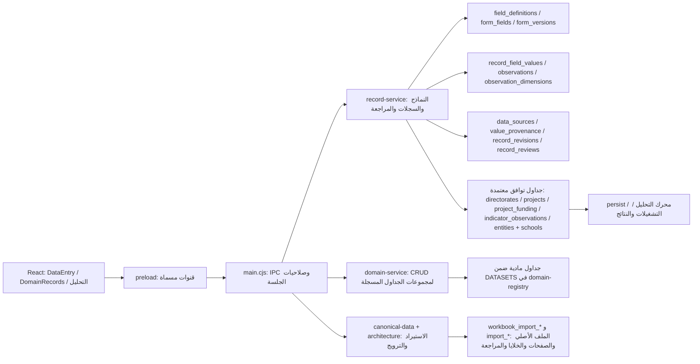

# جرد المعمارية الحالية لمنصة البيانات التنموية

**نطاق الجرد:** فحص الشيفرة الحالية في فرع `feat/complete-manual-entry-catalog`، شاملاً التغييرات المحلية غير الملتزمة. هذا الجرد يصف المسارات التي يثبتها التنفيذ والاختبارات؛ لا يفترض أن أسماء الجداول أو وجود الواجهات يعني اكتمال الوظيفة.

## الخلاصة التنفيذية

قاعدة SQLite هي مخزن التشغيل الأساسي، والتطبيق يملك بالفعل بنية هجينة: قاموس حقول ومجموعات وأبعاد، تعريفات نماذج ذات إصدارات، سجلات وقيم وصفية، قياسات متعددة الأبعاد، كيانات رئيسية، جداول قطاعية/مالية متخصصة، طبقة استيراد ومراجعة، وخدمات تحليل. لا يلزم استبدالها بمخزن جديد.

لكن «مصدر الحقيقة» ليس موحداً وظيفياً بعد: توجد سجلات قطاعية مباشرة عبر `domain-service`، وسجلات نماذج عامة عبر `record-service`، ومسارات توافق/تحليل أقدم، وقاموس واجهات ثابت في `domain-registry.cjs` إلى جانب قاموس الحقول المركزي. كتالوج الإدخال اليدوي يصف المجال والتغطية ويربط الحقول المرشحة، لكنه ليس مشتقاً آلياً من شجرة `field_groups`. هذه طبقات ذات أغراض مختلفة جزئياً، لكنها تتقاطع بما يكفي لتحتاج عقوداً أوضح واختبارات انتقال قبل إيقاف أي مسار.

أضيف في هذا الفرع ربط سجل المدرسة/الروضة المعتمد بكيان تعليمي مركزي، مع ترحيل توافقي، كما أصبحت الأعمدة الفيزيائية التي لا يعرّفها سجل المجموعة للقراءة فقط ومرفوضة في الكتابة. هذا يغلق فجوتين محددتين ولا يعني اكتمال توحيد جميع القطاعات.

## خريطة التشغيل المثبتة

المسارات أعلاه ليست جميعها سلسلة موحدة: بعض الواجهات تقرأ وتكتب سجلات نماذج، وبعضها يخاطب الجداول المتخصصة المسجلة مباشرة. لا يوجد دليل يبرر نقل كل كتابة إلى مسار واحد قبل اختبار التوافق.

## مصفوفة المكونات والمسؤوليات

| المكوّن وموقعه | المسؤولية والبيانات | مصدره/وجهته الحالية | التقييم والفجوة المثبتة |
|---|---|---|---|
| `store-schema.cjs` و`store-schema.cjs:413-482` | تنسيق ترحيلات SQLite وفحوص سلامة البنية والمفاتيح الخارجية | يستدعي ترحيلات البيانات الكانونية، `architecture.cjs`، نموذجي التطوير V1/V2، المؤشرات والمستندات وكتالوج الإدخال | نقطة التهيئة المشتركة. كتالوج الإدخال والترحيل التعليمي الأخير يعملان بعد ترحيل المخطط الأساسي، ولكل منهما سجل ترحيل منفصل. لا تعدّل بصمات الإصدارات المنشورة. |
| `architecture-v1.sql` | الوحدات الجغرافية والفترات والمراجع والأبعاد والوحدات والكيانات والنماذج والسجلات والقيم والمصادر والمراجعات | بنية علائقية تشمل `field_definitions`, `form_fields`, `form_records`, `record_field_values`, `observations`, `observation_dimensions`, `entities`, `schools` | أساس مشترك صالح لإعادة الاستخدام. `form_fields` يربط تعريفاً مركزياً بالنسخة ويضيف إعدادات عرض/تحقق خاصة بالنموذج، وهو فصل مفيد ما دام لا يصبح تعريفاً دلالياً منافساً. |
| `unified-development-model-v1.sql` و`unified-development-model-v2.cjs` | جداول قطاعات ومالية وتخطيط ومؤشرات، وحقول مجموعات وأسماء بديلة وقواعد أبعاد | جداول متخصصة مثل `facility_services`, `staffing_observations`, `budget_lines`, `revenue_transactions`, `development_programs`, `indicator_components` | نموذج هجين لا EAV شامل. جداول وصف الكيان/المعاملة تبقى متخصصة؛ القياسات متعددة الأبعاد في `observations`. ترحيلات V2 توسعية وتضيف حقولاً/سياسات دون تعديل تاريخي منشور. |
| `manual-entry-catalog.cjs` | تصنيف مجالات ومجموعات متطلبات الإدخال، روابط مرشحة إلى قاموس الحقول، ونماذج جمع أولي وحالة المنهجية | `manual_entry_domains`, `manual_entry_groups`, `manual_entry_group_field_candidates`, `manual_entry_form_governance`, `manual_entry_form_field_governance` | كتالوج تغطية/حوكمة فوق القاموس والنماذج، وليس مخزناً للقيم. 18 مجالاً و86 مجموعة. الروابط المرشحة ليست اعتماداً دلالياً. توجد صيانة تعريفات المجال في كود ثابت، لا اشتقاق كامل من `field_groups`. |
| `record-service.cjs` | توليد تعريف النموذج، التحقق والحفظ والقراءة والتعديل، الأبعاد والمصادر والمراجعات والاعتماد | يكتب القيم الوصفية إلى `record_field_values` والقياسات إلى `observations` وأبعادها إلى `observation_dimensions` | المسار الديناميكي المشترك. يتطلب حالياً نشر نسخة النموذج للحفظ، مع السماح بنشر نماذج جمع أولي موسومة غير مؤهلة للتحليل. مزامنة الجداول الكانونية تتم عند اعتماد النماذج المحددة في الخدمة. |
| `domain-registry.cjs` + `domain-service.cjs` | قائمة سماح ثابتة لمجموعات الجداول الفعلية وحقولها وأنواعها ومراجعها؛ قراءة/حفظ/حذف مع تحقق وتدقيق | يتعامل مع 45 مجموعة مسجلة عبر `DATASETS`، ويستعلم عن بنية الجدول الفعلية | ليست محرك نماذج ولا قاموساً دلالياً كاملاً. قبل هذا التغيير كانت الأعمدة الفيزيائية غير المسجلة تظهر كحقول قابلة للتحرير؛ صارت ظاهرة للقراءة فقط ويُرفض تمريرها للكتابة، إلى أن تُراجع وتُسجل صراحة. |
| `DomainRecords.jsx` و`DataEntry.jsx` | متصفح CRUD للمجموعات المسجلة، ومحرك نماذج عرض/إدخال بحسب تعريفات الخدمة | `DomainRecords` يستخدم `window.localApp.unified`؛ `DataEntry` يستخدم قنوات البيانات والسجلات من preload | واجهتان مختلفتان وظيفياً. لا يوجد دليل على أنهما يكتبان السجل نفسه معاً، لكنهما يقدمان مسارين ينبغي أن يظهرا للمستخدم بمصدر وحالة واضحين. |
| `DocumentsHub.jsx` و`Import.jsx` و`IndicatorObservations.jsx` و`DataQuality.jsx` | تبويبات الوصول إلى الوثائق والاستيراد والقياسات وتسوية قضايا الجودة | التحميل والكتابة عبر قنوات `documents:*`, `import:*`, `observations:*`, `quality:*` من preload | جرى جمع الصفحات في تنقل واحد؛ اختبار الربط يؤكد ظهور التبويبات الأربع، مع بقاء الخدمات والضوابط منفصلة. |
| `preload.cjs` و`main.cjs` | جسر IPC ضيق المسميات؛ كل قناة تستدعي خدمة رئيسية وتضيف تدقيق قراءة/كتابة أو سياق جلسة | قنوات `data:*` للنماذج والسجلات، و`unified:*` لمجموعات الجداول، و`analysis:*` للتحليل والتصدير | اختبار `unified-data-layer.test.cjs` يقارن كل قناة preload بمعالج main. يجب استمرار فحص الصلاحية في main/service وعدم كشف SQL أو أسماء جداول حرة للواجهة. |
| `canonical-data.cjs` و`architecture.cjs` | حفظ ملف Excel الأصلي وبصمته، تفكيك الأوراق والصفوف والخلايا، وتصنيف مناطق مرشحة؛ ثم الترويج المعتمد لبعض أنواع البيانات | `workbook_import_batches/sheets/regions/rows/cells` ثم صورة مراجعة منظمة في `import_*` وجداول كانونية منتقاة | Excel مصدر إدخال/أثر، لا مصدر حقيقة. الترويج للمشاريع والمؤشرات يمر بقرارات صريحة وفحوص تفرد وموقع وفترة ومصدر. لا تُحوّل كل ورقة إلى سجل معتمد تلقائياً. |
| `persist.cjs` ومحرك التحليل و`main.cjs:1444-1676` | بناء/حفظ التشغيلات والنتائج، القراءة والتصفية والتعديل والتصدير | مسار المديريات يقرأ سجلات مؤهلة عبر `entity_records` والقياسات المعتمدة، ويستخدم `directorates` لبيانات التوافق الوصفية | ليس كل نموذج أو مجموعة مدخلة جزءاً من التحليل. نموذج المؤشر الأولي لا يدخل مؤشرات رسمية حتى الاعتماد والتحقق. الأوزان والنتائج تحتاج إصداراً ومنهجية؛ لا تُستنتج من وجود قيمة رقمية. |

## مصادر الحقيقة الحالية وحدودها

| نوع البيانات | المصدر التشغيلي الحالي | علاقات/طبقات توافق | حدّ مثبت |
|---|---|---|---|
| المعنى الدلالي للحقل | `field_definitions` مع `field_groups`, `field_group_fields`, `field_definition_aliases`, `field_dimension_rules` | `form_fields` يختار الحقول وترتيبها ونوع التخزين والتحقق داخل نسخة نموذج | أسماء/أنواع بعض الحقول في سجل `DATASETS` وكتالوج الإدخال موجودة أيضاً في كود ثابت؛ لا يوجد إثبات أن جميع هذه التعريفات متطابقة أو محسومة. |
| طريقة عرض الإدخال | `form_definitions`, `form_versions`, `form_sections`, `form_fields` | جداول حوكمة الإدخال تربط النموذج بمواصفة المصدر وحالة التعريف والمنهجية | النماذج الأولية المنشورة صالحة للجمع لا للتحليل؛ نشر النموذج شرط حفظ، وليس اعتماداً للبيانات أو منهجيتها. |
| قيمة وصفية ضمن نموذج | `record_field_values` | مصدرها `data_sources` وتاريخها في `value_provenance`؛ مراجعات السجل في `record_revisions`/`record_reviews` | لا تُمثل تلقائياً خصائص كل كيان في الجدول المخصص ما لم يوجد ربط/مزامنة معلنة. |
| قياس | `observations` + `observation_dimensions` | يرتبط بتعريف حقل ووحدة وموقع وفترة ومصدر ونموذج | حالة القيمة تحفظ الصفر والغياب بأنواعه. تحليل رسمي يحتاج أهلية واعتماداً مستقلاً. |
| كيان مادي | `entities` وهوية النوع في `entity_types` وملف النوع مثل `schools` | `form_records.entity_id` يربط سجل النموذج بالكيان | قبل الإضافة الحالية لم يكن نموذج المدرسة الأولي يملأ هذا الربط عند الاعتماد. أصبح ذلك يتم عند الاعتماد، مع بقاء حقول المدرسة غير المحسومة في سجل النموذج الخام. |
| مشروع وتمويل | `projects` و`project_funding` وجداول الإصدارات | `form_record_legacy_links` يصلها بسجل النموذج المعتمد؛ التمويل يتطلب مشروعاً أباً معتمداً | يظل التخزين الفيزيائي المتخصص مقصوداً؛ لا تُنسخ مسودات التمويل إلى سجل التحليل. |
| ملفات الاستيراد | `workbook_import_*` مع الملف الأصلي والبصمة والخلية | `import_*` للمراجعة والمطابقة والقرارات والترويج | النسخة المرحلية دليل مصدر لا سجل تنموي كانوني. |
| نتائج التحليل | جداول التشغيلات/النتائج وتخزين التحليل في `store-schema.cjs` | مراجع تعريفات/أوزان/مدخلات التشغيل في بنية المؤشرات | بيانات الجمع غير المعتمدة لا تصبح رسمية بمجرد حفظها. |

## الجرد الكمي القابل لإعادة الإنتاج

شُغلت ترحيلات التطبيق على قاعدة SQLite مؤقتة في الذاكرة ثم عُدّت الصفوف؛ الأرقام التالية تصف تعريفات الشيفرة الحالية لا قاعدة مستخدم تشغيلية:

| المقياس | العدد | طريقة الحساب والتفسير |
|---|---:|---|
| المجالات | 18 | `COUNT(*) FROM manual_entry_domains` بعد `storeSchema.migrate(db)` |
| المجموعات | 86 | `COUNT(*) FROM manual_entry_groups`؛ مجموعات كتالوج/تغطية وليست كلها نماذج قابلة للإدخال |
| روابط الحقول المرشحة | 384 | `COUNT(*) FROM manual_entry_group_field_candidates`؛ حالتها مراجعة نطاقية، لا تُحسب اعتماداً أو تغطية دلالية مكتملة |
| نماذج الجمع الأولي المنشورة | 86 | `COUNT(*) FROM manual_entry_form_governance WHERE collection_mode='primary_collection'`؛ نموذجان بحقول موصوفة أولياً و84 نموذجاً آلياً لالتقاط المتطلبات الخام، وجميعها غير مؤهلة للتحليل |
| حقول نماذج الجمع | 300 | 8 في النموذجين ذوي الحقول الأولية، و292 نصاً خاماً موزعاً على 84 نموذج متطلب غير محسوم |
| تعريفات `field_definitions` | 718 | 68 مستخدمة في نماذج منشورة قائمة، و358 مرشحاً بحاجة لمراجعة، و292 حقل التقاط خام لا يساوي تعريفاً دلالياً معتمداً |
| مؤهلة للتحليل من نماذج الجمع الأولي | 0 | شرط `analysis_eligible=1`؛ يمنع الخلط مع النتائج الرسمية |
| مجموعات CRUD في سجل الخدمة | 45 | `Object.keys(domainRegistry.DATASETS).length` |

سجل المواصفة المتاح يحتوي 299 بنداً في 18 مجالاً و85 مجموعة. لكل من البنود الـ292 غير المصنفة كقدرات مشتركة نموذج جمع خام نصي؛ هذه الحقول تتيح حفظ العبارة/الإجابة الأولية ولا تدعي تفكيكها إلى تعريفات ذرية أو اعتماد نوع دلالي أو وحدة أو مصدر أو منهجية. ما زالت 279 بنداً تحتاج تصنيفاً على مستوى العنصر، و255 لها مرشحات غير معتمدة فقط، و18 لا ربط لها بحقل دلالي حالي؛ لذلك لا تمثل القائمة 299 تعريف حقل معتمداً ولا تسمح بنسبة اكتمال تشغيلية. تفاصيل العد والتصنيف في `manual-entry-requirement-register.csv` و`canonical-data-architecture.md`.

## الفجوات والتكرار والمخاطر

1. **معجم المجال ليس اشتقاقاً واحداً:** `field_definitions` هو أقرب قاموس دلالي، لكن `domain-registry.cjs` يكرر نوع/اسم كثير من أعمدة CRUD، و`form_fields` يحمل العرض والتحقق، وكتالوج الإدخال يضيف اسم المجموعة وروابط المرشحين. يلزم فصل مسؤولية التقنية عن المعنى الدلالي وتسجيل حالة تعريف الحقل في المرجع، لا حذف هذه الطبقات.
2. **مساران لإدخال القيم:** `DataEntry` يمر عبر سجل نموذج عام، بينما `DomainRecords` يكتب مباشرة إلى الجداول المتخصصة. الأول يدعم المراجعة/المصدر بشكل غني؛ الثاني له تدقيق وتحقق خاصان بالمجموعة. توحيدهما غير مكتمل، ويجب نقل كل نوع تدريجياً مع تحقق مقارن.
3. **حقول فيزيائية غير موصوفة:** الاستعلام عن أعمدة SQLite لا يجعلها معرفة دلالياً. التعديل الحالي يحصر الكتابة في الحقول المسجلة ويُبقي الأعمدة غير المسجلة مرئية للقراءة؛ ينبغي مراجعتها ثم إضافة سجل تعريف واختبار قبل تحريرها.
4. **المزامنة إلى الجداول المتخصصة غير عامة:** توجد فروع محددة في `record-service` للمديريات والمشاريع والتمويل وقياس المؤشر، وأُضيفت منشآت التعليم. يلزم وضع رابط التحويل في عقد معلن/قابل للتوسع بدلاً من تكاثر مزامنات غير متجانسة، مع الحفاظ على المعاملة والروابط القديمة.
5. **الاعتماد والتحليل طبقتان مختلفتان:** `record_status='approved'` لا يساوي اعتماد منهجية حقل أو المؤشر. الحوكمة الحالية تفصلها في نماذج الجمع، لكن لا يوجد مسار ترقية عام لكل تعريف مؤقت أو مصفوفة اختبار تمنع جميع أشكال تسرب البيانات إلى تقارير أخرى.
6. **المصادر والتاريخ:** تخزين المصدر والقيمة الأصلية والموقع ونسخ السجل متاح في المسار المركزي؛ ليس مؤكداً من الجرد أن جميع الكتابات المباشرة للقطاعات تسجل مصدرًا أو تاريخ قيمة بالمستوى نفسه. لا تُملأ بيانات غير موجودة افتراضياً.
7. **التوافق القديم:** `directorates` و`entity_records` ومسارات نموذج المديريات وجداول التحليل تتعايش. القراءة الفعلية للمديريات تستفيد من السجل المركزي المعتمد مع احتفاظها ببيانات ملف الاستيراد/التوافق. يجب إثبات الأعداد والتطابق قبل أي حذف أو إيقاف.
8. **التحقق الطرفي:** الاختبارات الحالية تثبت خدمات وقاعدة SQLite، بما فيها قياس متعدد الأبعاد وتمويل مشروع ومؤشر وExcel. لا يثبت ذلك وحده أن كل خطوة عرض/نقر في Electron تعمل على Windows أو Linux؛ لا يوجد في هذه المرحلة اختبار E2E للواجهة أو تحقق Windows.

## التغييرات التنفيذية في هذه الدفعة

- ترحيل إضافي `schema_migrations` رقم 9 يضيف نوع الكيان `education_facility` دون تغيير جداول أو تعريفات ترحيلات سابقة.
- ترحيل إضافي رقم 10 يربط السجلات التعليمية المعتمدة القديمة غير المرتبطة بكيانات؛ يسجل السجلات المؤجلة وسببها في تفاصيل الترحيل بدلاً من إسقاطها أو تخمين قيمها.
- عند اعتماد نموذج جمع المدرسة/الروضة: تنشأ/تُحدّث هوية `entities` وصف `schools`، وتُربط بـ`form_records.entity_id` وتُربط قياساتها بالكيان، مع حفظ أثر تحديث الكيان في `audit_events`. تظل الحقول غير محسومة داخل سجل الجمع ولا تُحوّل لقوائم موثوقة.
- أعمدة الجدول الفعلية غير المعرّفة في `domain-registry` لا تُحرر من واجهة CRUD، ويمنع `domain-service` قبولها حتى عند استدعاء الخدمة مباشرة.
- اختبارات الخدمة تثبت حفظ/إعادة قراءة/المصدر/المراجعة لقياس متعدد الأبعاد، والكيان التعليمي، وربط مشروع وتمويل، وعزل التحليل الأولي؛ لكنها لا تغطي جميع مجموعات المجالات ولا Electron E2E.

## مراجع الشيفرة والاختبارات

- المخطط الأساسي: `desktop-app/src/main/database/architecture-v1.sql`، خصوصاً تعريفات القاموس والنماذج والكيانات والسجلات والقيم والمصادر والمراجعات.
- الجداول القطاعية والمالية والتحليلية: `desktop-app/src/main/database/unified-development-model-v1.sql` و`desktop-app/src/main/database/unified-development-model-v2.cjs`.
- تنسيق الترحيلات: `desktop-app/src/main/analysis/store-schema.cjs:413-482`.
- كتالوج الإدخال وحوكمة النماذج: `desktop-app/src/main/database/manual-entry-catalog.cjs:9-228,350-694`.
- سجل CRUD: `desktop-app/src/main/database/domain-registry.cjs:1216-1253` و`desktop-app/src/main/database/domain-service.cjs:196-239,613-646,806-912`.
- دورة السجل والاعتماد والمزامنة: `desktop-app/src/main/database/record-service.cjs:244-373,376-420,757-862`.
- الجسر: `desktop-app/src/main/preload.cjs:11-25`؛ التسجيل والمعالجة في `desktop-app/src/main/main.cjs:1082-1143,1860-1925`.
- الاختبارات: `desktop-app/tests/canonical-data.test.cjs:201-321,789-884`، `desktop-app/tests/unified-data-layer.test.cjs:48-106,192-208`، واختبارات استيراد/promote في `desktop-app/tests/canonical-data.test.cjs:339-...`.
