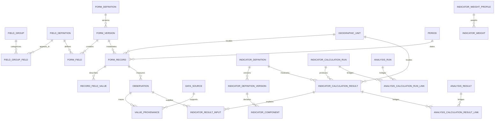

# تدقيق واكتمال معمارية بيانات التنمية المحلية

**المستودع:** `bww2728-png/nizam-altanmiya` · **الفرع الذي دُقّق:** `main` عند `a194d7c4f2d4190e1ad974ffbd5e79c6cda7e378` · **التاريخ:** 2026-11-11

## الخلاصة التنفيذية

دمج PR #11 ووسّع المخطط، لكنه لم يحوّل كل المسارات القديمة إلى مصدر واحد. أضاف الإصدار السابق قاموساً هرمياً ونماذج وسجلات ومؤشرات ومشاريع ومالية وتخطيطاً؛ وتبقى واجهات تشغيلية وبيانات توافق تستخدم الجداول السابقة. أثبت التشغيل هنا إنشاء المخطط ومراجع القاموس والاختبارات، لا ترحيل قاعدة مستخدم بعينها أو صلاحية كل قطاع إنتاجياً.

في هذا الاستكمال أُضيف تشغيل حساب قابل للتتبع فوق الجداول الموحدة: كل تشغيل جديد يحفظ مدخلاته ومصدرها وصيغته وأوزانه ونتائجه وبصمة المدخلات، ويرتبط بسجل النتيجة القديم مؤقتاً للقراءة التاريخية. بقيت الجداول القديمة ولم تتغير معادلات V3.3 أو أوزانها. تُحجب تفاصيل المدخلات عن وضع المشاركة.

**الحكم:** المعمارية الموحدة ليست بعد مصدر الحقيقة التشغيلي لجميع الوظائف. لا يصح وصف المهمة الكاملة بأنها مكتملة أو نشر إصدار نهائي بناءً على هذا الاستكمال وحده.

## تدقيق المستودع والإصدارات

| البند | دليل التحقق | الحالة |
|---|---|---|
| دمج نموذج البيانات السابق | PR #11 مدمج في `main` بتاريخ 2026-11-11، والالتزام النهائي أعلاه | `verified_complete` |
| PR مفتوح عند بدء التدقيق | `gh pr list --state open` أعاد قائمة فارغة | `verified_complete` |
| CI السابق | تشغيل الدمج `43029314533` ناجح؛ شغّل التطبيق أيضاً على Linux وWindows في workflow الجودة | `verified_complete` |
| آخر إصدار سابق | `v0.6.15` (11 نوفمبر 2026) | `verified_complete` |
| حماية `main` | GitHub API أعاد 404 «Branch not protected» | `verified_complete`؛ حماية الفرع غير مفعلة بحسب API |
| بيانات مستخدم فعلية | لا توجد قاعدة محلية للمستخدم ضمن مساحة العمل؛ قاعدة التحقق أُنشئت في الذاكرة فقط | `blocked` |
| نسخة Windows فعلية مع قاعدة قديمة | غير متاحة في هذه البيئة؛ CI يبني ويختبر Windows لكنه لا يختبر ملف المستخدم الحقيقي | `blocked` |

الـ workflows الموجودة هي `.github/workflows/desktop-quality.yml` (Linux وWindows: اختبارات، بناء، Electron E2E) و`.github/workflows/release.yml` (مثبت Windows x64 وإصدار GitHub). نجاح CI لا يثبت اكتمال البيانات الحقيقية أو ترقية قاعدة مستخدم.

## منهج الجرد والنتائج

- شُغّلت ترحيلات `store-schema.cjs` و`canonical-data.cjs` و`architecture.cjs` والنموذج الموحد على قاعدة SQLite اختبارية جديدة؛ فحص الترحيل أنشأ 143 جدولاً واجتاز `integrity_check` و`foreign_key_check`.
- جرى مسح ساكن لاستدعاءات SQL في `src/main` و`src/renderer`. يلتقط أسماء الجداول الظاهرة في `FROM`/`JOIN`/`INSERT`/`UPDATE`/`DELETE`، ولا يثبت تنفيذ مسار IPC أو الاستعلامات المبنية ديناميكياً؛ لذا لا يُعامل كجرد دلالي نهائي.
- اختبار `npm test` قبل التغيير: 215 ناجحاً، 0 فشل، اختبار واحد متجاوز عمداً من 216. بعد التغيير نجحت المجموعة الكاملة: 219 ناجحاً، 0 فشل، اختبار واحد متجاوز عمداً من 220؛ نجح بناء Vite محلياً أيضاً. فشل أول تشغيل للمجموعة بسبب تأكيدين قديمين يثبتان رقم migration=2؛ حدّث الاختبار ليقرأ `MIGRATION_VERSION` الحالي ثم أُعيدت المجموعة ونجحت. هذا لا يثبت ترقية قاعدة مستخدم حقيقية أو بناء Windows.
- لا يوجد ملف قاعدة مستخدم لاستخراج عينة ترحيل تاريخية حقيقية. لذلك لا تُختلق أعداد نقل أو مصادر أو فترات مفقودة.

## مصفوفة مسؤوليات البيانات ومصدر الحقيقة

| نوع البيانات | الجداول المرجعية المستهدفة | الحالة التشغيلية الحالية والحد |
|---|---|---|
| تعريف الحقل والاسم المعياري | `field_definitions` | المرجع المركزي للتعريف، مع حاجة إلى ربط كل المسارات والحقول المتبقية |
| المجال الهرمي وعرض الحقل ضمن مجال | `field_groups`, `field_group_fields` | 18 مجالاً مزروعاً؛ بعض التعريفات غير مربوطة بمجموعة، والربط لا يثبت تغطية الملفات الفعلية |
| الاسم البديل والمطابقة | `field_definition_aliases` | 433 اسماً؛ 56 فقط معتمدة في قاعدة الاختبار. الاقتراح غير المعتمد ليس قرار مطابقة |
| الوحدة والأبعاد والتصنيفات | `measurement_units`, `dimension_definitions`, `dimension_values`, `reference_sets`, `reference_values` | قاموس موجود؛ لا يوجد دليل تغطية كامل لكل قطاعات الملفات الفعلية |
| المكان والفترة | `geographic_units`, `periods` | معرفات مركزية؛ بعض البيانات التاريخية بلا فترة أو رمز جغرافي رسمي، ويجب إبقاؤها غير محسومة |
| هوية السجل والنموذج والإصدار | `form_records`, `form_definitions`, `form_versions`, `form_record_legacy_links` | نموذج مركزي وجسر المديريات موجودان؛ الإدخال/الاستيراد legacy ما زال يكتب مسارات توافق بالتوازي |
| القيم الوصفية | `record_field_values` | مناسبة لقيم النموذج؛ لا تزال البيانات المدخلة القديمة مزدوجة مع جداول المديريات وبعض المسارات لا تمر حصراً بالخدمة المعيارية |
| القياسات الزمنية | `observations`, `observation_dimensions` | المسار العام موجود؛ `indicator_observations` ما زال مسار توافق منفصلاً يحتاج ترحيل/إيقاف مرحلياً |
| المصدر وموضع القيمة | `data_sources`, `value_provenance`, `managed_attachments` | توفر المراجع والتخزين؛ المصدر والخلية/الصف لا يتوفران لكل البيانات التاريخية، فلا يجوز اختلاقهما |
| المشاريع والتمويل | `projects`, `project_funding`, `project_versions`, `project_activities`, `project_milestones` | `projects` و`project_funding` مستخدمان في مسارات إدارة واستيراد؛ الربط الشامل بالسجل/الخطة/القياس لم يثبت |
| الموازنات والإيرادات والنفقات | `financial_accounts`, `budget_headers`, `budget_lines`, `revenue_transactions`, `expenditure_transactions` | الجداول موجودة؛ اكتمال واجهات الاستخدام والتسويات والاختبارات المالية غير مثبت |
| تعريفات المؤشرات وإصداراتها | `indicator_definitions`, `indicator_definition_versions`, `indicator_components` | أُنشئت إصدارات للصيغ الاثنتي عشرة الحالية عند الترحيل؛ لا تمثل اعتماداً منهجياً جديداً |
| الأوزان والمستهدفات | `indicator_weight_profiles`, `indicator_weights`, `indicator_targets`, `indicator_benchmarks` | كل وزن فعلي يحفظ لكل تشغيل؛ ملفات الأوزان المسجلة غير معتمدة تلقائياً ولا تُعد مرجعاً رسمياً |
| تشغيل الحساب ومدخلاته ونتائجه | `indicator_calculation_runs`, `indicator_calculation_results`, `indicator_result_inputs` | **أُوصلت للتشغيل الجديد**؛ كل تشغيل يحفظ مساري `replica` و`calibrated` وبصمة/صيغة/مدخلات/وزن/نتيجة. النتائج القديمة لا تُرحّل بأثر رجعي هنا |
| نتائج التوافق التاريخية | `analysis_runs`, `analysis_results` | تبقى لقراءة التاريخ والهوية؛ نتائج التشغيل الجديد مرتبطة بالنتيجة الموحدة، وتُعاد قراءتها منها عند استعراض التشغيل |
| الاستيراد الخام والمراجعة | `workbook_import_*`, `import_*` | تخزين واكتشاف ومراجعة موجودة؛ الترقية العامة لكل أنواع المناطق والقطاعات غير مكتملة |
| الجودة والتدقيق والإصدارات | `data_quality_issues`, `record_revisions`, `audit_events`, `access_log` | توجد آليات متخصصة؛ تغطية كل كتابة وكل سجل قطاعي غير مثبتة |

## تغطية قاموس المجالات في ترحيل اختباري جديد

الأعداد أدناه هي تعريفات مرتبطة بمجال أو بأحد أبنائه في القاعدة الاختبارية، وليست نسبة تغطية لمصادر ميدانية. يمكن أن يظهر الحقل ضمن أكثر من عرض مجال.

| رمز المجال | المجال | تعريفات مرتبطة |
|---|---|---:|
| `geography` | البيانات الإدارية والجغرافية | 23 |
| `population` | السكان والأسر والتركيبة الديموغرافية | 10 |
| `poverty` | الفقر ومستويات المعيشة والاقتصاد الأسري | 17 |
| `protection` | الفئات المستهدفة والحماية الاجتماعية | 17 |
| `environment` | الموارد الطبيعية والبيئة والمناخ | 38 |
| `society_culture` | المجتمع والثقافة والموروث | 20 |
| `governance` | الإدارة المحلية والحوكمة والمؤسسات | 24 |
| `education` | التعليم ومحو الأمية | 27 |
| `health` | الصحة والخدمات الصحية | 22 |
| `youth_sports` | الثقافة والشباب والرياضة | 7 |
| `infrastructure` | البنية التحتية والخدمات الأساسية | 26 |
| `agriculture` | الزراعة والري والثروة الحيوانية والسمكية | 34 |
| `economy` | الصناعة والقطاع الخاص والأنشطة الاقتصادية والسياحة | 15 |
| `finance` | المشاريع والتمويل والموازنات والإيرادات | 17 |
| `indicators` | المؤشرات التنموية والقياس والمقارنات | 14 |
| `analysis` | التحليل التنموي والقضايا والأولويات | 25 |
| `planning` | التخطيط الاستراتيجي والبرامج والمشاريع | 18 |
| `metadata` | البيانات المشتركة والتوثيق والجودة | 23 |

ملخص قاعدة الاختبار السابقة للاستكمال: 423 تعريف حقل، 377 رابط مجال، 433 اسماً بديلاً (56 معتمداً)، 44 مجموعة مرجعية، 232 قيمة مرجعية، 24 وحدة، 4 تعريفات أبعاد و16 قيمة بُعد. الفرق بين عدد الحقول وروابط المجال، والعدد المحدود من الأسماء البديلة المعتمدة، فجوات تحتاج مراجعة؛ لا يُعد كل تعريف مغطى لمجرد وجوده.

## خريطة الاستخدام: الواجهة ← IPC ← الخدمة ← الجداول

| الوظيفة | الواجهة/IPC | الخدمة والجداول الفعلية | النتيجة |
|---|---|---|---|
| إدخال المديرية | `DataEntry.jsx` ← `directorate:*` | `persist.saveManualDirectorate` ← `directorates` ثم مزامنة إلى `form_records`, `record_field_values`, `observations` | يعمل عبر جسر كتابة مزدوج؛ ليس مساراً موحداً حصرياً |
| عرض السجلات | واجهات `canonical-data:*` و`record:*` | `canonical-data.cjs`, `record-service.cjs` ← السجلات الموحدة وجداول التوافق | مسارات مختلفة بحسب نوع السجل |
| استيراد Excel | `Import.jsx` / `DocumentCenter.jsx` ← `import:*` و`workbook:*` | staging خام ثم خطط اعتماد محدودة | الترقية العامة لكل المجالات غير مكتملة |
| المشروع والتمويل | واجهات المركز/المشاريع ← project IPC | `canonical-data.cjs`/`architecture.cjs` ← `projects`, `project_funding` ونسخ/مرفقات | مسار قائم؛ التكامل الشامل مع بيانات الخطة والتحليل غير مثبت |
| لوحة المؤشرات والترتيب | `Ranking.jsx` ← `analysis:run`, `analysis:latest`, `analysis:runs`, `analysis:calculation-detail` | `engine.cjs` و`persist.cjs` ← مدخلات مديرية معتمدة، ثم جداول الحساب الموحد؛ الجداول القديمة للربط التاريخي | الحساب الحالي محفوظ الآن بمصدره، مع بقاء التوافق التاريخي |
| تفاصيل مدخل الحساب | `Ranking.jsx` ← `analysis:calculation-detail` | `indicator_result_inputs`, `value_provenance`, `data_sources` | متاح للمالك فقط؛ المشاركة لا تستلم هذه القيم |
| التقارير والتصدير | exporter / report IPC | مدخلات ونتائج المحرك والتوافق | تقارير الحزمة القديمة لم تُحوّل جميعها للقراءة المباشرة من جداول النتائج الموحدة |
| النسخ الاحتياطي والتحديث | `db:*`, `electron-updater` | `store.cjs`, `store-schema.cjs`, سير عمل Windows | يوجد ترحيل ذري واختبارات استعادة؛ اختبار قاعدة المستخدم وترقية Windows الحقيقية ما زال مطلوباً |

## مخطط ERD للجزء الموحد الذي أصبح تشغيلياً

جداول `analysis_calculation_*_links` توافق انتقالية صريحة؛ لا تمحو التاريخ القديم. لا يحول هذا الرسم الجداول القطاعية والمالية غير الموصولة إلى وظائف تشغيلية.

## مصفوفة فجوات ومتطلبات التنفيذ

| المعرف | المجال والمتطلب | التنفيذ الحالي / الدليل | الحالة | الفجوة والأثر | الإجراء ومعيار القبول |
|---|---|---|---|---|---|
| `ARCH-01` | مصدر حقيقة ومسؤولية بيانات واضحة | مخطط موحد بالإضافة إلى جداول توافق سابقة | `partially_complete` | مسارات قراءة/كتابة مزدوجة للمُدخلات والمشاريع والمؤشرات | نقل كل وظيفة على حدة، إثبات الواجهة وIPC والخدمة والمخزن قبل تحويل الجسر إلى قراءة فقط |
| `DICT-01` | قاموس الحقول والمجالات الثمانية عشر | 423 تعريفاً، 377 رابط مجال، 433 alias (56 معتمداً) | `partially_complete` | لا توجد مجموعة ملفات ميدانية كاملة ولا تعريف موثق لكل أسماء الأعمدة؛ 46 تعريفاً أكثر من روابط المجموعة | حصر المصادر وتسجيل التغطية والمراجعة الدلالية لكل حقل، دون افتراض مرادفات |
| `REF-01` | جغرافيا وفترات ووحدات وأبعاد مرجعية | جداول مرجعية وقواعد تحقق واختبارات موجودة | `partially_complete` | رموز رسمية وحدود سريان وبيانات قديمة غير مؤرخة ليست متاحة لكل سجل | مصدر جغرافي/زمني رسمي ثم ترحيل مع قائمة غير المحسومين؛ اختبارات منع اليتيم والحلقات |
| `REC-01` | السجل الموحد والقيم والقياسات والحالات | `form_records`, `record_field_values`, `observations`; إدخال legacy يزامن إليها | `partially_complete` | ليست كل شاشات الإدخال تكتب عبر خدمة السجل وحدها؛ حالات القيم لا تتبع كل المصادر بالتساوي | تحويل الواجهة إلى record-service واختبار المسودة/المراجعة/الاعتماد والتاريخ والحالات الست |
| `ENT-01` | الكيانات القطاعية والجغرافية | جداول قطاعية متعددة؛ القاموس يربط بعض الحقول | `implemented_not_integrated` | وجود الجداول لا يثبت استخدامها في الإدخال والتقارير لكل مجال | تكامل قطاعي موثق باختبار دورة كاملة قبل إعلان كل قطاع نشطاً |
| `PROJ-01` | المشروع والتمويل والموقع والخطة والأنشطة | `projects`, `project_funding` ونسخ/أنشطة موجودة؛ استيراد مشاريع محدود | `partially_complete` | لم يثبت توحيد كل الشاشات والميزانية/المعاملات والخطط مع المشروع نفسه | مصفوفة تحويل وتكامل واجهات وتقارير واختبار FK ومجاميع مالية قبل إيقاف المسارات القديمة |
| `FIN-01` | الموازنة والإيراد والنفقات بعملة دقيقة | الجداول المرجعية موجودة | `implemented_not_integrated` | لم يثبت تنفيذ دورة مالية أو تدقيق الدقة والتسويات | تحديد قواعد العمل/العملة والمصادر أولاً؛ اختبار المبالغ الدقيقة والمجاميع والتقارير |
| `IND-01` | تعريف وإصدار ومعادلة ووزن المؤشر | أُنشئت إصدارات للصيغ الاثنتي عشرة؛ اختبار مطابقة القالب قائم | `partially_complete` | 12 مؤشراً لا تمثل قاموس كل قطاع؛ اعتماد الأوزان مؤسسي لا برمجي | لكل مؤشر منهجية ومصدر واعتماد وإصدار ومكونات ذات FK؛ لا تعديل منهجي ضمن ترحيل البيانات |
| `IND-02` | تخزين تشغيلات المؤشرات ومدخلاتها | حفظ المسارين والأوزان والصيغ والمدخلات/المصدر والبصمة، وروابط النتائج | `verified_complete` للنظام الجديد فقط | النتائج التاريخية القديمة لا تحمل مدخلات معيارية بالضرورة ولا يمكن تخمينها | لا backfill إلا من بيانات موثقة؛ اختبر إعادة القراءة والتكرار والبصمة وتطابق الأرقام |
| `ANL-01` | استبدال نتائج التحليل القديمة مصدراً مباشراً | نتائج التشغيل الجديدة تُقرأ من الجداول الموحدة؛ `analysis_*` يحتفظ بسجل التوافق | `partially_complete` | تقارير/تاريخ قديم يحتاج مساراً توثيقياً؛ تفاصيل كل محرك قديم لم تُهاجر | تحويل كل المستهلكين، ثم إبقاء جسر قراءة محدد؛ إزالة الكتابة القديمة بعد إثبات الاستخدام صفر |
| `IMP-01` | استيراد موحد لكل الكيانات والمناطق | تخزين أصلي ومراجعة وترقية محدودة للمديريات/المشاريع/المؤشرات | `partially_complete` | المناطق والكيانات العامة تبقى staged أو legacy | اعتماد خريطة ومسار review لكل نوع، منع التطابق/الاعتماد غير المؤكد، اختبار إعادة الاستيراد |
| `SRC-01` | أصل القيمة حتى ملف/ورقة/صف/خلية | مصدر وبصمة وموضع عند توافرها؛ القيم الجديدة تحفظ provenance | `partially_complete` | الإدخال اليدوي والتاريخ القديم قد لا يملكان عنوان خلية | اختبر المسار الكامل على قيم موجودة؛ النقص يظل معلناً ولا تُختلق مواقع |
| `QLT-01` | الجودة والتدقيق والإصدارات لجميع البيانات | جداول وخدمات وجودة قطاعية موجودة | `partially_complete` | لا يوجد إثبات تغطية لكل جداول القطاعات ونقاط الكتابة | تعداد كل عمليات الكتابة واختبار الحدث السابق/الجديد/الفاعل/السبب بلا أسرار |
| `UI-01` | كل الوحدات تستخدم المصدر المعتمد | صفحة الترتيب تعرض زر حفظ الحساب المعياري والتفسير للمالك | `partially_complete` | بقية 30 وظيفة ليست مختبرة على المسار الموحد بالكامل | خريطة IPC/الخدمة/الجدول لكل وحدة واختبار Electron E2E لكل مجموعة |
| `DB-01` | ترحيل آمن وعدم فقدان قاعدة المستخدم | ترحيل v3 إضافي، transaction، `integrity_check` وFK؛ اختبار ترقية اصطناعي من سجل v2 | `partially_complete` | لم تختبر نسخة قاعدة مستخدم فعلية ولا Windows/SQLCipher لدى المستخدم | احتفظ بنسخة مشفرة خارج المستودع، نفذ تجربة clone/restore على بيئة Windows مع قياس counts/payload |
| `TST-01` | Linux وWindows وElectron E2E ونتائج قديمة | اختبارات محلية وبوابات CI موجودة | `partially_complete` | لا تمثل CI بيانات المستخدم؛ يجب نجاح تشغيل CI لهذا الفرع أولاً | CI أخضر مع اختبارات migration/E2E/restore، ثم إثبات عمل إصدار قديم وبيانات اختبار ممثلة |
| `REL-01` | PR ودمج وإصدار تحديث صحيح | v0.6.15 هو آخر إصدار مدقق | `partially_complete` | هذا الفرع لا يثبت اكتمال المشروع الكبير أو ترقية مستخدم حقيقي | لا تنشر إصداراً يعلن المعمارية كاملة؛ إصدار مرحلي فقط بعد مراجعة/CI وتعريف واضح للنطاق |

## استراتيجية الانتقال

`Expand → Migrate → Verify → Contract`:

1. إضافة مخطط وروابط جديدة مع إبقاء القديمة وبيانات المستخدم.
2. حفظ التشغيلات الجديدة في المخطط الموحد والمعرفات القديمة كجسر.
3. مقارنة العدّ، النتائج، القيم، المصدر، الفترة والعلاقات؛ الإيقاف عند أي اختلاف غير مفسر.
4. تحويل قارئ/كاتب كل وحدة واختبار الواجهة والـ IPC والتقارير.
5. لا تحذف أو توقف جدول توافق قبل قياس استخدامه صفراً وإثبات الاستعادة.

ترحيل البيانات القديمة يجب أن يبقى قابلاً لإعادة التشغيل ومعرّفاً بمفتاح المصدر. الفترات غير المتوفرة، المصادر غير المسجلة، التعارضات والسجلات غير القابلة للمطابقة تبقى في تقرير مراجعة لا في بيانات مخمّنة. لا تُرفع قاعدة البيانات أو مفتاح SQLCipher أو النسخ الاحتياطية إلى GitHub.

## دليل إضافة مؤشر أو حقل ضمن هذا المسار

- أضف تعريف الحقل بمعرف/رمز ثابت ونوع ووحدة/مرجع ومجال مناسب، ثم رابط مجموعة واختبارات الاسم البديل. لا تعتمد alias جديداً تلقائياً.
- أضف صيغة المؤشر وإصدارها ومكوناتها المرجعية واختبار تطابق مستقل مع عينة معتمدة؛ لا تعدل إصداراً مستخدماً بصمت.
- أضف المدخلات من `observations` أو `record_field_values` مع مصدرها وحالتها، ثم ثبت القيمة والصيغة والوحدة والأوزان في كل تشغيل.
- أضف اختبارات إعادة الحساب والتفسير والمفقود والصفر والتسريب في وضع المشاركة، ثم حدّث مصفوفة هذا المستند بالأدلة.

## دليل ترحيل قاعدة البيانات

- لا تعدّل migration منشوراً ولا checksum تاريخياً؛ أضف إصداراً جديداً.
- اجعل DDL/ترحيل البيانات داخل المعاملة الموجودة، مع FK/index/unique/collision policy معلنة.
- اختبر قاعدة فارغة وقاعدة v2 قديمة اصطناعية، وإعادة التشغيل، والفشل المتعمد في منتصف المسار.
- قبل بيئة حقيقية: أنشئ نسخة احتياطية مشفرة قابلة للفتح والاستعادة، لا تعمل على قاعدة الإنتاج، واحفظ counts وhashes قبل/بعد.
- اختبر التحديث من المثبت السابق ونسخة بيانات ممثلة على Windows؛ لا تعتبر نجاح قاعدة الاختبار في الذاكرة بديلاً عنه.

## الاختبارات التي أضيفت في هذا الاستكمال

`tests/indicator-calculation-persistence.test.cjs` يثبت حفظ تشغيلين (مطابقة ومعايرة) و26 نتيجة وبيانات المدخلات، وربط المصدر/المعادلة/إصدار القالب، تطابق القيم القديمة والجديدة، الذرية عند غياب سجل معتمد، ترقية v2 دون فقد تاريخ، وحجب التفاصيل في وضع المشاركة. يجب تسجيل نتائج الاختبارات الكاملة وCI لهذا الفرع هنا بعد تشغيلها؛ لا تُستنتج من وجود الملف.
