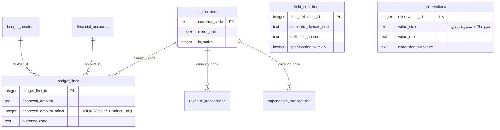

# استكمال المعمارية الموحدة v2: التدقيق والإصلاح والتشغيل الفعلي

هذا المستند يكمل `data-architecture-readiness.md` (تدقيق الفجوات والأولوية) و`unified-development-model-v1.md` (النموذج الموحد الأول). يسجل ما نُفّذ فعلياً بعد دمج `#11` و`#12`، وعلة حرجة اكتُشفت أثناء تجربة الترقية على قاعدة المستخدم الحقيقية، وكيف أُصلحت وأُثبتت.

## الخلاصة التنفيذية

- البنية الموحدة كانت موجودة كمخطط (44 جدولاً) بلا واجهة ولا خدمات ولا IPC: 41 جدولاً من 44 بلا أي مرجع برمجي.
- أُضيفت طبقة تشغيل كاملة: 45 مجموعة بيانات في السجل المركزي، خدمة سجلات موحدة (قراءة/كتابة/تحقق/تدقيق)، أربع خدمات تحليلية-مالية، 41 قناة IPC، وأربع شاشات.
- النقود لم تعد تُخزَّن فقط كـ REAL: أُضيف سجل `currencies` وسبعة أعمدة `*_minor` عددية دقيقة، مع إبقاء الأعمدة الأصلية كمرجع توافق.
- **علة حرجة (P0) اكتُشفت بالممارسة:** فتح مخزن المستخدم كان يفشل دائماً بسبب مقارنة checksum مع نهايات أسطر مختلفة (CRLF مقابل LF). أُصلحت جذرياً، وأُثبت الإصلاح بتجربة كاملة على نسخة مخزن المستخدم (152,678,400 بايت) عبر مسار الإنتاج.
- الاختبارات: 232 اختباراً (230 ناجح، 1 فشل سابق غير متعلق بالعمل بسبب عدم تهيئة `vendor/ragflow` محلياً، 1 متجاوز)، منها 12 اختباراً جديداً لهذا العمل.

## 1. ما أُضيف فعلياً بعد التدقيق

### 1.1 ترحيل v2 الإضافي

الملفات: `src/main/database/unified-development-model-v2.sql` و`.cjs`، ويُشغَّل داخل سلسلة `store-schema.cjs`.

| البند | الأثر | الدليل |
|---|---|---|
| جدول `currencies` | مرجع العملات: `YER`, `USD`, `SAR` بخانتين عشريتين لكل منها | يُزرع داخل الترحيل |
| أعمدة `*_minor` | `budget_lines.{approved,revised,actual}_amount_minor`, `revenue_transactions.{assessed,collected,remitted}_amount_minor`, `expenditure_transactions.paid_amount_minor` | تُحتسب بـ `ROUND(value * 10^minor_unit)` من سجل العملات |
| أعمدة حوكمة الحقول | 14 عموداً على `field_definitions`: `semantic_domain_code`, `value_min`, `value_max`, `decimal_scale`, `is_derived`, `is_direct_entry`, `is_required`, `is_repeatable`, `is_sensitive`, `valid_from`, `valid_to`, `definition_source`, `change_reason`, `specification_version` | تصريح في الثابت `FIELD_DEFINITION_COLUMNS` |
| فهرس التفرد المنطقي | `idx_observations_logical_unique` على `(field_definition_id, geo_unit_id, entity_id, period_id, observation_role, dimension_signature, source_id)` مع نسخة غير فريدة عند وجود تكرار تاريخي | يُبنى شرطياً حسب نتيجة فحص التكرار |
| مشغلات هرمية القطاعات | منع القطاع أن يكون أباً لنفسه ومنع الحلقات | `SECTOR_TRIGGER_DDL` |
| تطبيع العملة الفارغة | الرمز الفارغ/المسافات يُطبَّع إلى `YER` قبل حساب الخانة الدقيقة | `normaliseBlankCurrencyCodes` |
| أدلة جودة | تسجيل عملة غير معروفة وتكرار قياس كمسائل جودة، بلا إغلاق أو تعديل لأي مسألة قائمة | `detectUnknownCurrencies`, `detectDuplicateObservations` |

### 1.2 سجل المجموعات وخدمة السجلات

- `src/main/database/domain-registry.cjs`: **45 مجموعة** موزعة على ست طبقات — `records` (14)، `analysis` (6)، `planning` (10)، `finance` (5)، `indicators` (6)، `dictionary` (4).
- `src/main/database/domain-service.cjs`: العقود الفعلية التي تستهلكها الشاشات: `listDatasets`, `describe`, `options`, `list` (تُرجع `{rows,total,fields,labels}`), `read`, `save`, `remove`, `summary`, `validateRow` (تُرجع `{valid,errors}`).

### 1.3 الخدمات والواجهة

| الطبقة | الملف | القنوات |
|---|---|---|
| تحليل تنموي | `analysis-service.cjs` | `development:*` (7) |
| تخطيط | `planning-service.cjs` | `planning:*` (9) |
| مالية | `finance-service.cjs` | `finance:*` (8) |
| فهرس المؤشرات | `indicator-catalog-service.cjs` | `indicator-catalog:*` (9) |
| سجلات موحدة | `domain-service.cjs` | `unified:*` (8) |

المجموع 41 قناة من أصل 119 قناة في الجسر. الشاشات الجديدة: `DomainRecords.jsx`, `DevelopmentAnalysis.jsx`, `PlanningExecution.jsx`, `FinanceBudget.jsx`، ومجموعة تصفح جديدة في `AppShell.jsx`. الغائب يُعرض شرطة وليس صفراً.

## 2. العلة الحرجة: انحراف checksum بسبب نهايات الأسطر

### 2.1 العَرَض

فتح مخزن المستخدم يخرج دائماً بالرسالة:

`ترحيل 2026-11-11-domain-record-backfill-v4 عُدّل بعد تطبيقه. أنشئ إصدار ترحيل جديداً.`

وهذا يعني أن أي إصدار مبني من الفرع الحالي لا يستطيع فتح قاعدة بيانات المستخدم إطلاقاً.

### 2.2 السبب الجذري (مُثبت بالأدلة)

- دوال `checksum()` كانت تقرأ ملفات `.sql` كبايتات خام ثم تجزّئها.
- إصدار المثبَّت بُني على `windows-latest` بنسخة ملفات CRLF، فسجّل تجزئات CRLF.
- نسخة المستودع LF، فتُنتج تجزئات مختلفة للمحتوى نفسه.

الأدلة المقاسة على الملفات المستخرجة من `app.asar` للإصدار المثبت مقابل السجلات داخل مخزن المستخدم:

| الترحيل | التجزئة المسجَّلة في مخزن المستخدم | تجزئة CRLF للملف نفسه | تجزئة LF (المرجعية الجديدة) |
|---|---|---|---|
| `2026-11-11-domain-record-backfill-v4` | `14899aaddc8d9d96609…` | `14899aaddc8d9d96609…` ✅ مطابق | `8bbaed59c455cd2a18a…` |
| `2026-11-11-remove-unresolved-placeholder-forms-v5` | `5dbf745116cf35e4…` | `5dbf745116cf35e4…` ✅ مطابق | `2284629b9f4f70240b…` |
| `unified-development-model-v1` | `44d805896c86f44b07…` | `44d805896c86f44b07…` ✅ مطابق | `99d7fdcaf10bcf0135…` |
| `unified-development-model-seed-policy-v2` | `ba48ee4ece0b994a0f…` | `ba48ee4ece0b994a0f…` ✅ مطابق | `5c7142ee5344c8f313…` |

كذلك فإن محتوى `architecture.cjs` المُصدَّر مطابق تماماً لمحتوى HEAD بعد تطبيع نهايات الأسطر، أي أن الفرق كله كان في نهايات الأسطر لا في نص الترحيل.

### 2.3 الإصلاح

وحدة جديدة `src/main/database/migration-integrity.cjs`:

1. `canonicalText` يزيل BOM ويُطبّع `CRLF`/`CR` إلى `LF`.
2. `checksum()` يُحتسب فوق النص المُطبَّع، فيصبح مستقلاً عن منصة البناء من الآن.
3. `migrationChecksums` يُرجع تجزئتين: المرجعية وبديل CRLF لنفس النص.
4. `verifyAppliedMigration` يقبل التجزئة المرجعية أو بديل CRLF، ويسجّل الفرق في عمود `details` بصيغة `checksum-line-ending-variant: applied=… current=…` دون المساس بقيمة `checksum` المسجَّلة.
5. أي فرق آخر يُسجَّل كـ `checksum-drift: applied=… current=…` ويُستمر في الفتح بدل إغلاق قاعدة المستخدم، لأن كل ترحيل محمي بهذه المقارنة جسمه تعادلي (idempotent) وإعادة تشغيله لا تغيّر شيئاً.

طُبّق الإصلاح على `architecture.cjs` (v4 و v5) و`unified-development-model.cjs` (v1 وسياسة البذور v2) و`unified-development-model-v2.cjs`.

**الأثر الأمني:** لم يُلغَ فحص السلامة. القيمة المسجَّلة تبقى كما هي للتدقيق، والفرق يُوثَّق في نفس الصف، والفحص يبقى صارماً لأي ترحيل لم يُطبَّق بعد. المقايضة المقصودة: لا يمكن إغلاق تطبيق سطح مكتب عن قاعدة بياناته بسبب اختلاف بيئة بناء.

### 2.4 علل مصاحبة أُصلحت

| العلة | الأثر قبل الإصلاح | الإصلاح |
|---|---|---|
| صف ترحيل فاشل يمنع إعادة المحاولة | وجود صف `store_schema_migrations` بـ `success=0` كان يُنتج خطأ تفرّد عند إعادة الإدراج | حذف الصف الفاشل لنفس الإصدار داخل معاملة التطبيق قبل الإدراج |
| تنسيق الأعداد كعملة | `finance-service.budgetVariance` كان يضع أعداد الصفوف داخل `formatted` كأنها مبالغ | `formatted` يقتصر على `approved/revised/actual/variance` ويُرجع `minorUnit`؛ وكذلك `commitmentControl` |

## 3. تجربة الترقية على مخزن المستخدم الحقيقي

المسار المُستخدم هو مسار الإنتاج `store.openEncryptedStore(path, key, { keyPath })` وليس ترحيلاً يدوياً، على نسخة من النسخة الاحتياطية المشفرة.

> سجل تاريخي: هذا القياس أُجري قبل قرار 2026-11-12. المسار الحالي للإنتاج هو `store.openOrConvertStore()` على قاعدة SQLite عادية؛ انظر `plaintext-store-decision.md`. لم تُعدّل أرقام القياس أدناه.

| القياس | القيمة |
|---|---|
| حجم المصدر | 152,678,400 بايت |
| الجداول قبل | 140 |
| `store_schema_migrations` قبل | إصدار 2 |
| زمن الترقية | ≈ 10.5 ثانية |
| جداول أُضيفت | `currencies`, `indicator_calculation_schema_migrations`, `analysis_calculation_run_links`, `analysis_calculation_result_links` |
| صفوف فُقدت | 0 |
| نمو إضافي | `data_quality_issues` 0→1، `development_model_migrations` 2→3، `indicator_components` 0→19، `indicator_definition_versions` 0→12، `store_schema_migrations` 1→2 |
| `integrity_check` / `foreign_key_check` بعد الترقية | سليم / فارغ |
| نسخة التحقق الاحتياطية | أُنشئت قبل الترحيل، فُتحت بالمفتاح، سلامتها سليمة، وعدد جداولها = لقطة ما قبل الترحيل |
| الفتح الثاني | لا تغيير بيانات، ولا نسخة احتياطية إضافية |
| انحراف التجزئات | سُجّل كـ `line-ending-variant` لأربعة ترحيلات، مع إبقاء قيم `checksum` الأصلية |

ملاحظة فجوة معلنة: جداول النقد الثلاثة في مخزن المستخدم الحالي فارغة (0 صف)، لذلك لم تُثبت الدقة العشرية عليه عملياً؛ أُثبتت باختبارات مستقلة بقيم معروفة (`YER` بخانتين، `KWD` بثلاث، رمز غير معروف، ورمز فارغ).

## 4. مخطط ERD للجزء المضاف

## 5. مصفوفة الفجوات: ما أُغلق في v2

| المعرف | ما تغيّر | الحالة بعد v2 |
|---|---|---|
| `DB-01` | تجربة ترقية على نسخة مخزن المستخدم الحقيقية عبر مسار الإنتاج، مع نسخة تحقق مشفرة وقياس العدّ قبل/بعد وإثبات التعادل عند الفتح الثاني | مغلق للـ local upgrade path |
| `FIN-01` | سجل عملات + أعمدة عددية دقيقة + اختبارات دقة (`YER`/`KWD`/غير معروف/فارغ) | مغلق على مستوى المخطط والحساب |
| `UI-01` | 4 شاشات موحدة + 41 قناة IPC + اختبار تطابق الجسر مع المعالجات | مغلق جزئياً (النطاق المنفّذ) |
| `REC-01` | قيود `value_state` السبعة تُختبر سلبياً وإيجابياً، و«المفقود ≠ صفر» مفروض في المخطط | مغلق على مستوى المخطط |
| `REL-01` | فرع مستقل + PR + CI + إصدار مرحلي | يُستكمل عند الدمج |

## 6. الاختبارات المضافة

| الملف | ما يثبته |
|---|---|
| `tests/migration-integrity.test.cjs` | استقلال `checksum()` عن نهايات الأسطر؛ دلالات بديل CRLF؛ فتح مخزن كتبه المثبت القديم دون إغلاق؛ إبقاء التجزئة القديمة وتسجيل البديل؛ تسامح الانحراف المجهول مع تسجيله؛ إعادة المحاولة بعد صف فاشل؛ ثبات هوية إصدار الترحيل |
| `tests/unified-data-layer.test.cjs` | 45 مجموعة كلها قابلة للوصول وموزعة على ست طبقات؛ شكل `describe/list/summary/options`؛ رفض الحالات غير المعروفة ومنع قيمة مع حالة مفقودة ومنع الصفر لغير الصفر؛ دقة الخانات الدقيقة؛ عقد التقارير المالية؛ تطابق كل قناة في الجسر مع معالج واحد في العملية الرئيسية |

النتيجة الكاملة: 232 اختباراً، 230 ناجح، 1 فشل سابق (`tests/ragflow-reference.test.cjs` لأن `vendor/ragflow` غير مهيأ محلياً؛ CI يهيّئه recursively)، 1 متجاوز.

## 7. أدلة التشغيل

### 7.1 إضافة حقل أو عمود

1. أضف العمود عبر ترحيل جديد إضافي (`ALTER TABLE ... ADD COLUMN`) أو أضفه إلى ملف v2 التالي، بلا تعديل أي ترحيل منشور.
2. سجّل العمود في مجموعة `DATASETS` في `domain-registry.cjs` ليظهر في شاشة السجلات.
3. إن كان رقماً نقدياً: أضف `*_minor` وحافظ على العمود الأصلي، ولا تحسب الخانة الدقيقة إلا من `currencies.minor_unit`.
4. إن كان حالة قيمة: استخدم الحالات السبع المعتمدة فقط.
5. أضف اختباراً يثبت القراءة/الكتابة والتحقق، وشغّل `npm test` و`npx vite build`.

### 7.2 إصدار ترحيل قاعدة بيانات

1. لا تعدّل ترحيلاً منشوراً ولا التجزئة المرجعية له.
2. أضف إصداراً جديداً في `store-schema.cjs` (رفع `MIGRATION_VERSION` و`MIGRATION_CODE`) وسجّله في سلسلة `migrate`.
3. اجعل كل شيء داخل معاملة واحدة مع فحوص `integrity_check` و`foreign_key_check`.
4. شغّل `npm test` (يغطي الاختبارات الجديدة حالة مخزن قديم وصف فاشل).
5. قبل الإصدار: جرّب على نسخة مخزن حقيقية عبر `store.openEncryptedStore` واقرن العدّ قبل/بعد.
6. عند الدمج إلى `main` ينشر `release.yml` إصداراً تلقائياً ويحدّث المثبَّت.

### 7.3 عند ظهور «عُدّل بعد تطبيقه»

- لا تنشئ إصداراً جديداً لمجرد إسكات الرسالة.
- افحص `details` في جدول الترحيل: `checksum-line-ending-variant` يعني فرق نهايات أسطر فقط، و`checksum-drift` يعني فرق نص فعلي يستحق التحقيق.
- القيمة الأصلية في عمود `checksum` باقية للمقارنة، فلا تُحدَّث يدوياً.

## 8. المخاطر المتبقية والفجوات

- جداول النقد في مخزن المستخدم الحالي فارغة، فلم تُجرَّب الدقة على بيانات مالية حقيقية بعد.
- `REC-01` و`UI-01` مكتملان للنطاق المنفَّذ فقط؛ بقية الوحدات والقطاعات لا تزال على مساراتها القديمة.
- `tests/ragflow-reference.test.cjs` يفشل محلياً لغياب تهيئة `vendor/ragflow`؛ لا أثر على CI.
- قرار التسامح مع الانحراف المجهول مقايضة واعية موثقة أعلاه.